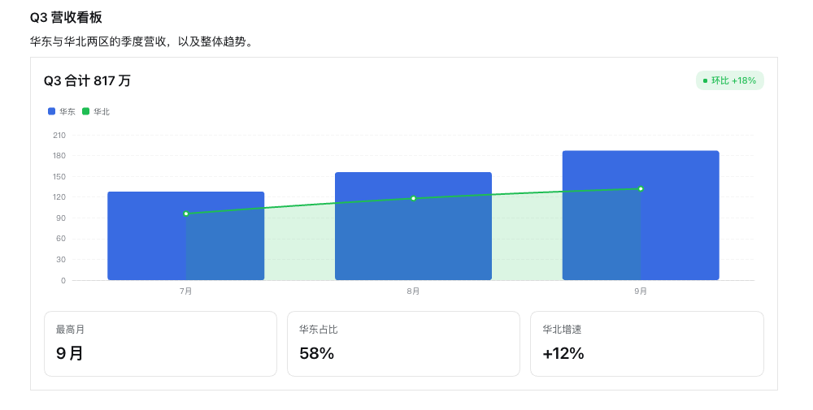
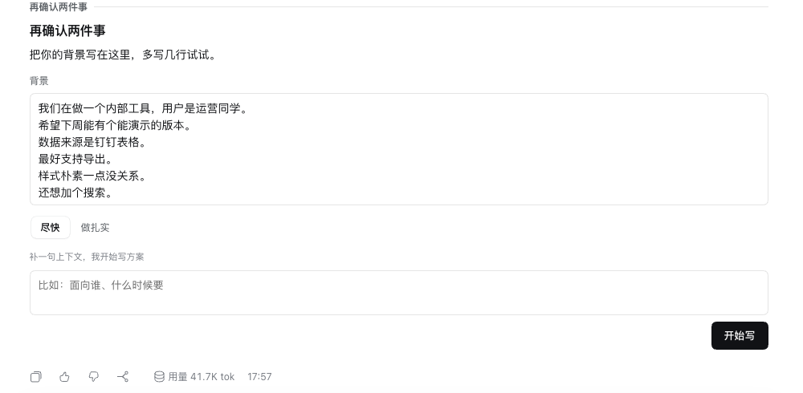

# Intelligent UI · 智能界面

**让 DSH 的回答变成「文字 + 富卡片」。**

模型用 **DIL** 写界面——Markdown 写文字，JSX 风格标签写组件，JavaScript 写状态与计算。
宿主编译成一份 JavaScript **程序** + 一张**常量表**；浏览器在沙箱里执行这份程序，
产出一串**操作**；页面把操作应用到自己原生的组件树上，用 DSH 的设计系统渲染。

拖动滑块、勾选开关、切换选项都在**浏览器本地完成，不会再调用模型**；
只有人按下提交时，答案才作为下一条用户消息回到模型。

这套分层是对 ChatGPT Intelligent UI 的反推实现。



---

## 目录

- [它是什么](#它是什么)
- [安装](#安装)
- [两个工具](#两个工具)
- [DIL 速查](#dil-速查)
- [支持的组件与交互](#支持的组件与交互)
- [答案怎么回到模型](#答案怎么回到模型)
- [卡片出现在哪里](#卡片出现在哪里)
- [设置](#设置)
- [开发与测试](#开发与测试)
- [目录结构](#目录结构)
- [已知限制](#已知限制)
- [参与开发](#参与开发)
- [许可](#许可)

---

## 它是什么

参考实现把工作分给模型、后端、客户端和设计系统四层。这四层在 DSH 上各有落点：

| ChatGPT Intelligent UI 里的层 | 这里的实现 | 位置 |
|---|---|---|
| 推理格式：Markdown + JSX 风格标签 + JS | DIL，放在工具的 `dil` 参数里 | `lib/compile.js`、`index.js` |
| 服务端编译成 JS 程序 + JSON 文档 | 宿主在调用时编译，把「原文 / 程序 / 常量表」三件套存进工具结果的 `presentationMeta` | `index.js` |
| 按目录校验与修复 | 编译期丢弃未知属性与类型不符的字面量并记录诊断 | `lib/compile.js`、`lib/catalog.js` |
| 流式半成品编译 | 每一段部分参数都重新编译；未写完的语句丢弃、未闭合标签自动闭合 | `lib/compile.js`、`src/client/app.js` |
| 沙箱运行时（隐藏 iframe → Worker → lockdown） | Blob Worker，首个程序前摘掉网络、定时器、消息与动态求值；另有 iframe 与页内降级 | `src/runtime/runtime.js` |
| 调和器产出 UI 操作 | 小型 keyed 调和器：绝对键 hook 槽、树 diff、整数编码操作流 + 字符串表 | `src/runtime/runtime.js` |
| 渲染成原生组件 | 按目录渲染，颜色/间距/圆角全走 `--dsw-*` token | `src/client/components.js` |
| 设计系统与组件目录 | 49 个组件 + 4 个复合组件 + 5 套 token | `lib/catalog.js` |
| 用 DIL 写的复合组件，预编译下发沙箱 | `statRow`、`pricingCard`、`productCard`、`choiceCard` | `lib/composite.js` |
| AppBlock 逃生舱 | **未实现**。在 DSH 上它的等价物是一个完整的客户端插件，不是内联的一个块。 | — |

两个刻意的设计决定：

- **`{表达式}` 才是插值**，`$` 是普通文字，所以 `${price}` 会渲染成 `$29`。
  这不是解析器的意外：反推得到的常量表里，源码 `${price}/mo` 对应的是
  `"4": "$"` 与 `"5": "/mo"`，只有把 `$` 当作普通文字才说得通。提示词里写明了这条，
  模型可以主动用它来输出货币符号。
- **属性表达式不逐个包裹**。只有属性里含表达式的元素整体包一层 `__dilSafe`，
  于是某个属性抛错只掉这一个元素。反推抓包里也是这样（`value: seats` 是裸的，
  外面套一层包裹的 `__dil.jsx`）。

---

## 安装

这是一个 **bundle**：一个 npm 包，同时带宿主半体（`index.js`）和浏览器半体（`client.js`）。

```sh
# 从 npm
dsh plugin --profile <你的 profile> add @comeonzhj/dsh-intelligent-ui

# 从 GitHub（想固定版本就带 commit）
dsh plugin --profile <你的 profile> add github:comeonzhj/dsh-intelligent-ui
```

装完**重启该 profile**——bundle 成员集合在启动时确定。之后该 profile 下所有 agent 都能用这两个工具。

> **为什么包名带 scope**：npm 上的 `dsh-intelligent-ui` 已经是另一位作者的 DSH 生成式 UI 插件。
> 用一个只差后缀的名字容易混淆，所以这里用作者 scope，概念名保持不变。

### 只想先试试，不装进任何 profile

```sh
node scripts/dev-profile.mjs --boot
```

它会写一个 `--patch` overlay（用绝对路径挂载本仓库），必要时创建一个叫
`intelligent-ui-dev` 的 profile 并启动，然后打印带鉴权 token 的地址。
全程不碰你正在用的 profile。

> **如果 `dsh plugin add` 卡住**：你 `PATH` 里的 `pnpm` 有问题（某些 shim 会
> `pnpm dlx dlx dlx …` 无限递归）。用 app 自带的那份：
> `/Applications/DeepSeek Harness.app/Contents/Resources/runtime/pnpm/bin/pnpm.mjs`，
> 包一层放到 `PATH` 前面即可。

## 两个工具

卡片有两种截然不同的用途，所以给了两个工具，而不是一个带开关的工具：

| 工具 | 用途 | 是否带反馈入口 |
|---|---|---|
| `render_ui` | **交付**一张卡片。卡片就是回答本身，调用完就停。 | **没有** |
| `ask_with_ui` | 任务进行中**向人提问**，把选项和控件放进卡片，必须给 `ask`。 | 有（提交按钮 + 可选备注框） |

为什么分开：**最终交付物里不该有反馈入口**。
会话本身就有输入框，而且原生输入框更好用——它能带附件、斜杠指令、输入历史。
在交付卡片末尾再挂一个「是否满意」，只会让一个已经完成的回答显得没完成。

这条不只是写在提示词里：`render_ui` 的参数表里根本没有 `ask`，
模型就算硬塞也会被宿主丢掉并记一条 `ask_not_allowed` 诊断。



提问卡片只在 `ask_with_ui` 下出现，并且**整张卡只有一个提交入口**——
要么是卡片里模型自己写的 `<button submit/>`，要么是底部的提交按钮，二者只留一个。

---

## DIL 速查

```
## Team plan estimate
Drag the slider to see the **monthly price** for your team.
{@body const [seats, setSeats] = DIL.useState(8)}
{@body const price = seats * 29}
<box border padding={3} gap={2}>
  <slider min={1} max={50} value={seats} onChange={setSeats} name="seats"/>
  <title size="xl">${price}/mo</title>
</box>
```

编译结果（节选）：

```js
function __dilSafe(evaluate, failureValue) { try { return evaluate(); } catch { return failureValue; } }

DIL.render(__dil.jsx(() => {
  const __dilConstants = DIL.useConstants();
  const [seats,setSeats] = DIL.useState(8, { key: "seats" });
  const price = __dilSafe(() => (seats * 29), undefined);
  return __dil.jsx(__dil.Fragment, null,
    __dil.jsx("title", { size: "lg" }, __dilConstants["0"]),
    __dil.jsx("text", null, __dilConstants["1"], __dil.jsx("bold", null, __dilConstants["2"]), __dilConstants["3"]),
    __dil.jsx("box", { border: true, padding: 3, gap: 2 },
      __dilSafe(() => __dil.jsx("slider", { min: 1, max: 50, value: (seats), onChange: (setSeats) }), null),
      __dil.jsx("title", { size: "xl" }, __dilConstants["4"], __dilSafe(() => (price), null), __dilConstants["5"])));
}, { key: "body:2" }));
```

常量表：`{"0":"Team plan estimate","1":"Drag the slider to see the ","2":"monthly price","3":" for your team.","4":"$","5":"/mo"}`

四个机制各有各的理由：

- **只生成普通函数调用**——运行时不需要 DIL 解析器。
- **静态文字进常量表**——流式过程中，长的文字改的是数据而不是程序。
- **状态键固定**（`{ key: "seats" }`）——每次重编译状态都不丢。
- **表达式隔离**——一个抛错的表达式只掉一个元素，不会毁掉整次渲染。

| 写法 | 含义 |
|---|---|
| `# …` `## …` | `title`，字号按层级给 token |
| `**粗**` `*斜*` `` `码` `` `[文字](链接)` `> 引用` `- 项` ` ``` ` | 对应组件 |
| `<tag a="s" b={e} flag>子节点</tag>`、`<tag/>` | 目录里的组件 |
| `{表达式}` | 插值 |
| `{@body …}` 独占一行 | 渲染体里的语句，渲染前执行 |
| `DIL.useState / useMemo / useRef / useCallback / useEffect` | 状态 |
| `{}` 里用 `DIL.h(类型, 属性, 子节点)` | 动态子节点，配合 `.map()` |

---

## 支持的组件与交互

### 可交互组件

操作全部在浏览器本地完成，**不会**调用模型。带 `name` 的控件会把当前值计入答案。

| 组件 | 交互 | 计入答案的值 |
|---|---|---|
| `<slider>` | 拖动 | `value`（数字）|
| `<stepper>` | 加减 | `value`（数字）|
| `<rating>` | 点星 | `value`（数字）|
| `<switch>` | 开关 | `checked`（布尔）|
| `<checkbox>` | 勾选 | `checked`（布尔）|
| `<segmented>` | 点选 | `value` |
| `<radio>` | 单选 | `value` |
| `<select>` | 下拉 | `value` |
| `<input>` | 单行输入 | `value`（文本）|
| `<textarea>` | 多行输入，**自动增高、无缩放手柄** | `value`（文本）|
| `<option>` | 点击选中（`choiceCard` 的积木）| 通过 `onClick` + `<field>` |
| `<button>` | 点击；`submit={true}` 提交整张卡 | — |
| `<form>` | 容器；`submitLabel` 生成提交按钮 | 内部所有带 `name` 的控件 |
| `<tabs>` / `<tab>` | 本地切换标签页 | — |
| `<reveal>` | 展开 / 收起 | — |
| `<link>` | 打开链接 | — |

### 图表

用 Apache ECharts 绘制（vendor 的是 common 构建，698 KB，随 `client.js` 内联）。

| `<chart type>` | 说明 |
|---|---|
| `bar` | 柱状；`horizontal={true}` 变条形；多 series 自动分组，`stacked={true}` 堆叠 |
| `line` | 折线；`smooth` 平滑、`area` 填充、`dashed` 虚线 |
| `area` | 折线 + 填充 |
| `pie` / `donut` | 饼图 / 环图，切片可各自带 `tone` |
| `scatter` | 散点，`symbolSize` 调点大小 |

- 单条 series 可以用自己的 `type` **覆盖**，所以柱线混排一张图就够。
- `categories` 省略时取第一条 series 的 x。
- `legend`、`valueFormat`（`number` / `currency` / `percent`）、`min` / `max`、`height`、`labels`、`symbols` 都可调。
- 类目超过 24 个自动加缩放条。
- 明暗主题切换时图表会重新取色（token 从 `--dsw-*` 读成字面量喂给 canvas）。

`<sparkline>` 是另一条路：一条内联 SVG 路径，不启图表实例，适合卡片里的小趋势。

### 复合组件（用 DIL 写、预编译下发）

| 组件 | 说明 |
|---|---|
| `<statRow>` | 一排指标块（`items` + `columns`）|
| `<pricingCard>` | 套餐卡：名称、价格、特性列表、行动按钮 |
| `<productCard>` | 商品卡：图、标题、价格、评分、行动按钮 |
| `<choiceCard>` | **推荐的提问方式**：选项变成可选中的卡片块 |

### 静态展示组件

`box` `row` `grid` `card` `divider` `spacer` `scroll` `columns`
`title` `text` `bold` `italic` `code` `caption` `label` `kbd` `quote` `callout` `list` `item`
`table` `kv` `stat` `progress` `badge` `pill` `avatar` `image` `gallery` `icon`
`sparkline` `timeline` `steps` `codeblock` `json`

`<field>` 不画任何东西，只声明一对 name/value，供复合组件把自己的选择塞进答案。

### 设计 token

| 类别 | 取值 |
|---|---|
| `padding` / `gap` / `spacing`（间距）| `0`–`8` → 0/4/8/12/16/24/32/48/64 px |
| `radius` | `none` `sm` `md` `lg` `xl` `panel` `full` |
| `size` | `xs` `sm` `md` `lg` `xl` `2xl` `3xl` |
| `weight` | `regular` `medium` `semibold` `bold` |
| `tone` | `neutral` `muted` `brand` `success` `warn` `error` `info` |
| `background` | `none` `base` `layer-1` `layer-2` `layer-3` `overlay` |

`css` 是唯一的逃生舱，只建议在 token 表达不了时用。

---

## 答案怎么回到模型

没有新造 RPC。提交时客户端把整张卡的**具名值**收集起来，拼成一条普通用户消息，
用 `session.prompt(..., 'steer')` 送出去：

```
[Intelligent UI] 续费方案 — the user answered the card you rendered (call call-1).

- seats: 10
- plan: yearly
- note: 4 月开始，需要发票
```

于是它天然是持久的会话事件，模型下一轮直接读到，不需要任何特殊通道。
收集规则：

1. 带 `name` 的控件 → `name: 当前值`（控件类型决定取 `value` 还是 `checked`）。
2. `<field name=... value=...>` → 直接一对。
3. `choiceCard` 之类的复合组件通过 `<field>` 把自己的选择交出来。

一个具名值都没有、也没有备注时，不发送。

---

## 卡片出现在哪里

卡片同时挂在两个位置，但任何时刻**只有一张完整卡片**：

- **`tool.call.toolview`**（按 `render_ui` / `ask_with_ui` 分派）——模型还在写参数时，
  这一轮还活着，工具行可见，卡片就在这里一行行长出来；调用一旦落地，这一行收成一句回执。
- **`conversation.chat.turnTail`**——成品卡片。`turn-tail` 是转录里少数**不参与折叠**的
  节点类型，所以一轮结束后卡片依然可见。

这个拆分不是装饰。DSH 标准转录视图会把每个工具调用折进「已完成，用时 N 秒」里——
对一条 shell 命令是合理默认，对一个**本身就是界面的回答**则是灾难。
桌面端固定了这个视图，web profile 默认 `detailed`（工具调用原地展开）。
turn tail 直接绕开了这个问题。

---

## 设置

`cordis.patch.yml` 里那条 row 带三个设置：

| 设置 | 默认 | 说明 |
|---|---|---|
| `prompt` | `true` | 是否把 DIL 协议与组件目录挂到系统提示词里 |
| `detail` | `full` | `full` 打印每个组件的全部属性；`compact` 每个组件一行 |
| `language` | `zh` | 工具描述与回执的语言 |

---

## 开发与测试

```sh
npm test     # 先构建 client.js，再跑 91 个测试
npm run build
npm run dev  # 起一个隔离 profile 试玩
```

```
compile.test.mjs   14  与反推抓包逐字对齐
runtime.test.mjs    9  操作流、本地交互、错误隔离
chart.test.mjs     18  数据 → ECharts option 的映射
catalog.test.mjs    9  渲染器覆盖、复合组件编译、全目录文档
client.test.mjs    15  部分参数解析、答案收集、消息形状
host.test.mjs      15  工具 schema、持久化记录、提示词段落
bundle.test.mjs    12  client.js 能被加载、lockdown 生效、程序能在沙箱里跑起来
```

`bundle.test.mjs` 是最有价值的一个：它用假的模块加载器执行生成的 `client.js`，
再把 runner 源码放进一个全新的 VM realm 跑起来，施加 lockdown，送一份编译好的程序，
最后用页面侧解码器还原操作流。它是唯一能抓住「bundle 注册不上」和
「lockdown 把加载器自己还要用的能力也删了」这两类错误的测试。

**改任何东西之后都要 `npm run build`**：`client.js` 是构建产物，但它**故意提交进仓库**，
这样 git 安装不需要构建步骤。

---

## 目录结构

```
index.js                  宿主半体：两个工具、宿主编译、提示词段落
client.js                 浏览器半体。由 scripts/build-client.mjs 生成，不要手改
lib/catalog.js            组件、属性、token、校验、目录文本
lib/compile.js            DIL → 程序 + 常量表 + 诊断；容忍半成品；不用 eval
lib/composite.js          复合组件，用 DIL 写，在 runner 内部编译
lib/prompt.js             DIL 协议、工具描述、回执
src/runtime/runtime.js    沙箱：hooks、调和器、操作编码、lockdown
src/client/chart.js       数据 → ECharts option（纯函数，可无 DOM 测试）
src/client/components.js  目录 → DSH 设计系统
src/client/app.js         两个卡片席位、流式、交互、答案通道
vendor/echarts.min.js     Apache ECharts（common 构建）+ 许可证
scripts/build-client.mjs  把模块摊平成 client.js 与 runner blob
scripts/dev-profile.mjs   写 --patch overlay 并启动隔离 profile
```

没有打包器，没有运行时依赖。DSH 插件的浏览器半体是一个注册进页面模块表的 CommonJS 闭包，
而这里的模块都是普通 ES module，唯一妨碍拼接的只有各自的 `import` / `export` 行——
所以构建就是几条正则、一次重名检查，以及落盘前的一次语法检查。

---

## 已知限制

- **没有 AppBlock 等价物。** 模型只能组合目录里的组件，不能塞进任意网页。
  参考实现也只对显式逃生舱放开这一点。
- **复合组件是纯函数。** 复合组件里调 `DIL.useState` 会让所有实例共享同一个槽，
  状态请放在卡片主体里。
- **一张卡片在时间上会有两个沙箱实例。** 工具行里的流式卡片与 turn tail 的成品卡片是
  两个 runner。它们不会同时是完整卡片，但在**参数仍在流式写入期间**做的交互不会带过去。
- **`presentationMeta` 必须是无损 JSON。** 一个 `undefined` 会让整个工具调用失败，
  不只是卡片；所以宿主对缺省字段是「不写」，而不是写 `undefined`。
- **文字里的尖括号。** 正文里的 `<` 会被当成标签开头；要字面量请放进组件里或避开。
- **图表类型受 vendor 构建限制**：雷达、仪表盘、热力图、漏斗等不在 common 构建里。
  换成完整版 `echarts.min.js`（1.12 MB）并调整目录里的类型列表即可，见 `vendor/README.md`。

---

## 参与开发

见 [CONTRIBUTING.md](CONTRIBUTING.md)。简版：

```sh
git clone https://github.com/comeonzhj/dsh-intelligent-ui
cd dsh-intelligent-ui
npm run build          # 生成 client.js（零依赖，纯 node）
npm test               # 91 个测试
npm run dev            # 起一个隔离 profile 试玩
```

改动 `lib/` 或 `src/` 之后**必须 `npm run build`**：`client.js` 是构建产物，
但它**故意提交进仓库**，这样 git 安装和 GitHub 安装都不需要构建步骤
（也正因为没有 `prepare` 脚本，pnpm 不会在安装时拦你）。

### 发布

```sh
npm login
npm publish            # prepare 会自动重建 client.js
```

改版本号用 `npm version patch|minor|major`，并同步更新 [CHANGELOG.md](CHANGELOG.md)。

## 许可

MIT。随包分发 Apache ECharts（Apache-2.0），见 `vendor/ECHARTS-LICENSE.txt` 与
`vendor/ECHARTS-NOTICE.txt`。

图表能力来自 [Apache ECharts](https://echarts.apache.org)；沙箱与渲染分层的设计参考了
OpenAI 的 ChatGPT Intelligent UI 实现分析。

English: [README.en.md](README.en.md)
